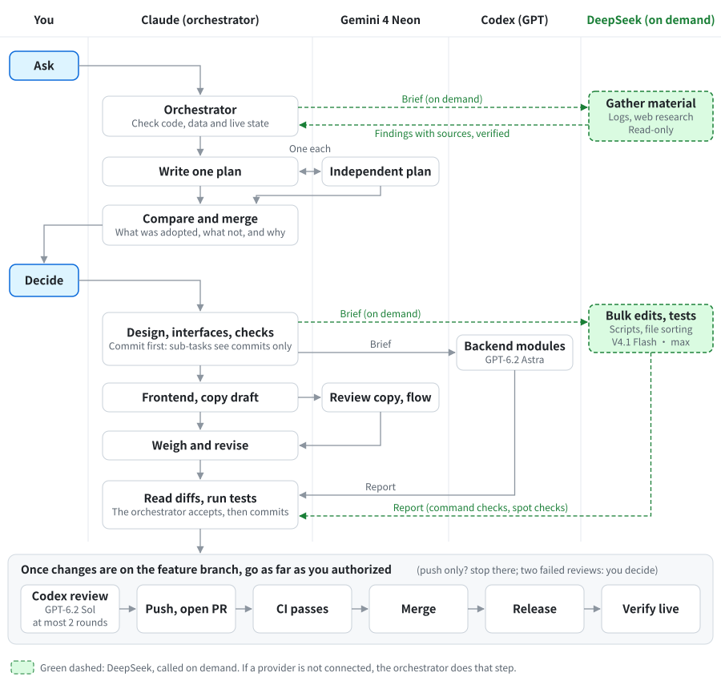
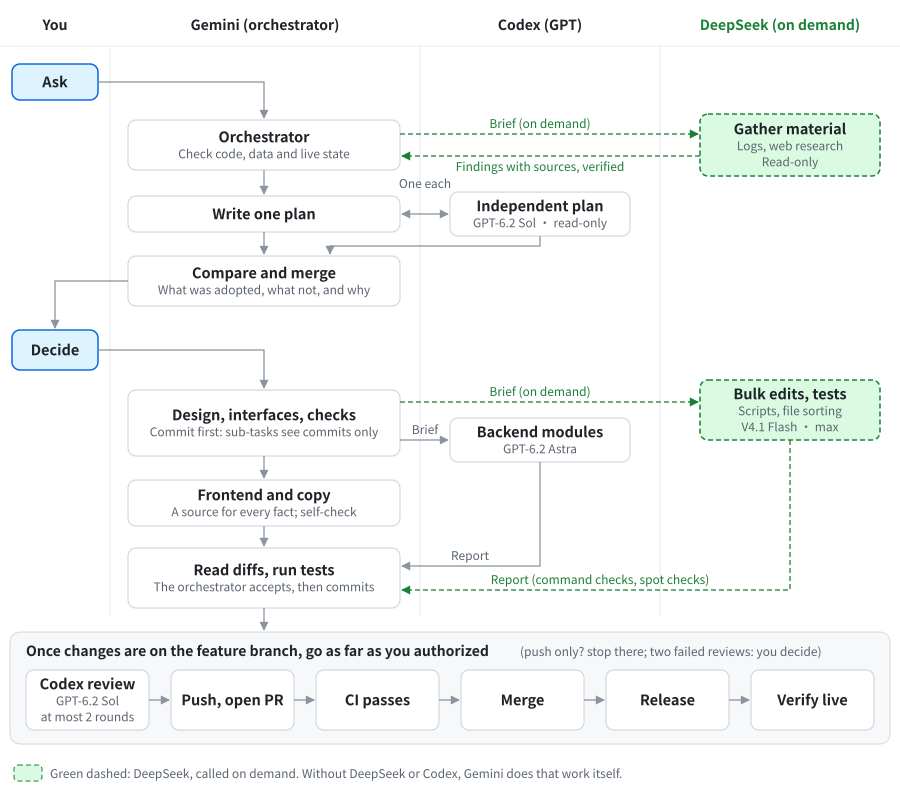

# t3-dispatch-skills

English | [中文](README.zh-CN.md)

> **Unofficial community tool** — not affiliated with or endorsed by T3 Tools Inc. Claude, Gemini, Codex, DeepSeek and other names mentioned here belong to their respective owners.

A skill pack that lets several AIs split the work automatically in the desktop app [T3 Code](https://t3.codes), so you stop relaying messages between windows. Claude or Gemini is the orchestrator: it sorts out the request, writes the frontend and checks the result. For big changes it brings in another model for an independent second plan to compare. Codex writes the heavy logic and guards the review before release; Gemini turns UI text into plain language; DeepSeek takes simple bulk work that burns through tokens. You do only two things: say what you need, and make the call.

## Two ways to use it

| Setup | Who it's for | Orchestrator | Must be connected in T3 Code | Optional (connect whatever you have) |
| --- | --- | --- | --- | --- |
| Standard | People who have Claude, Gemini and Codex | Claude | Claude, Antigravity (Gemini), Codex | CodeBuddy (DeepSeek) |
| Lowest bar | People without Claude who have Gemini and Codex | Gemini | Antigravity (Gemini), Codex | CodeBuddy (DeepSeek) |

Without DeepSeek, the orchestrator does the bulk work itself. In the standard setup you can start even if Gemini or Codex is missing for now: Claude does that step itself, but you lose the independent second plan or the independent review (the orchestrator tells you so). Sub-tasks can only be dispatched inside T3 Code; elsewhere the orchestrator does everything itself. The two diagrams below show the full split; to install right away, scroll down to "Install".

**Claude as orchestrator**



**Gemini as orchestrator (Gemini + Codex)**



## Install

Pick one setup based on the accounts you have, and follow only that one:

| You have | Pick | How to install |
| --- | --- | --- |
| Claude, Gemini and Codex | Standard | Run two commands to install the plugin (see **Option 1** below; skip Option 2) |
| No Claude, but Gemini and Codex | Lowest bar | Download this repo and run one script (see **Option 2** below; skip Option 1) |

**Note**: install only one setup, and only one language; installing both makes two sets of rules fight. If you installed the other setup or the other language before, uninstall it first using the steps at the end of its section. "Terminal" below means Terminal on macOS and PowerShell on Windows.

### Before you start (both setups)

1. Install the desktop app T3 Code (verified on v0.1.12).
2. Open T3 Code and connect and sign in to the AIs from the table above (Gemini is called Antigravity there, DeepSeek is called CodeBuddy).
3. **Option 2 requires Node.js** (the install script runs on it). Option 1 works without it; with Node.js installed, it picks the best-scoring Codex reasoning level for the day (if the scores can't be fetched it reuses the last result, and uses the default `high` only if it has never fetched one), and without Node.js `high` is always used.

### Option 1: Standard (Claude as orchestrator)

Claude in T3 Code shares the plugins of Claude Code on your computer, so installing once from the terminal is enough.

1. Make sure the Claude Code command line is installed (running `claude --version` in a terminal shows a version number; if not, install Claude Code following its official instructions).
2. Run these two commands in a terminal:

   ```
   claude plugin marketplace add anning777/t3-dispatch-skills
   claude plugin install t3-dispatch-skills-en@t3-dispatch-skills
   ```

   For the Chinese edition, use `claude plugin install t3-dispatch-skills@t3-dispatch-skills` as the second command. If you are already in a Claude Code terminal session, you can send `/plugin marketplace add anning777/t3-dispatch-skills` and `/plugin install t3-dispatch-skills-en@t3-dispatch-skills` instead.
3. Back in T3 Code, start a **new** conversation with Claude as the model (existing conversations won't pick it up). A hook adds the rules at the start of every new conversation; you don't need to change your own CLAUDE.md.
4. Check it worked: ask the new conversation "what multi-model dispatch rules do you have now"; if it describes the Claude-as-orchestrator split, you're done. **You're installed: jump to "Using it" and skip Option 2.**
5. Updating or uninstalling later (not needed for a first install): to update, run `claude plugin marketplace update t3-dispatch-skills` to refresh the catalog, then `claude plugin update t3-dispatch-skills-en@t3-dispatch-skills`, then start a new conversation; to uninstall, run `claude plugin uninstall t3-dispatch-skills-en@t3-dispatch-skills`. If you installed the Chinese edition, use the plugin name `t3-dispatch-skills` in both commands.

### Option 2: Lowest bar (Gemini as orchestrator)

Gemini in T3 Code doesn't read plugins; it only reads the rules and skills in the `~/.gemini/config` folder, so one script copies the files there.

1. Download this repo: click the green Code button at the top right of this page → Download ZIP, and unzip it into a folder (if you use git, you can run `git clone https://github.com/anning777/t3-dispatch-skills.git` instead).
2. Open a terminal, **go into the repo folder you just unzipped first**, then run:

   ```
   node scripts/install-gemini.mjs --lang en
   ```

   When you see a list of `installed` lines, it's done (the script has put the orchestrator rule at `~/.gemini/config/rules/t3-dispatch-skills.md` and the 6 skills in `~/.gemini/config/skills/`). For the Chinese edition, use `--lang zh`. If the folder already has same-named files it didn't install, the script stops right away, changes nothing, and lists the conflicting names for you to sort out first.
3. Back in T3 Code, start a **new** conversation with Gemini as the model (existing conversations won't pick it up).
4. Check it worked: ask the new conversation "what multi-model dispatch rules do you have now"; if it describes the Gemini-as-orchestrator split, you're done.
5. Updating or uninstalling later (not needed for a first install): to update, download the latest repo, go into the folder and run the same install command again (files you edited are kept, not overwritten). To uninstall, run `node scripts/install-gemini.mjs --uninstall`, which removes only the files it installed that you haven't edited; if the orchestrator rule line says `kept` (you edited it, so the script left it), that rule stays active. Move the file at the path printed on that line out of its rules folder to turn it off, then start a new Gemini conversation to check.

**Troubleshooting (only if the new conversation in step 4 still can't describe the rules)**: in rare cases T3 Code doesn't point Gemini's rules and skills folders at the default `~/.gemini/config` (check where `rules` and `skills` point in `providers/antigravity/<id>/config` under the T3 Code data folder). Then add `--dest <that config folder>` to install where it actually reads, and pass the same `--dest` for every later update and uninstall, for example `node scripts/install-gemini.mjs --lang en --dest "<that config folder>"` to update and `node scripts/install-gemini.mjs --uninstall --dest "<that config folder>"` to uninstall. Without it the script only looks at the default folder, and the rules in your custom folder stay active.

### Using it

In T3 Code, just open one conversation with the **orchestrator model** (Claude or Gemini) and say what you need, as usual; you don't switch to the other models yourself. Small changes the orchestrator makes directly; for big changes it gets two independent plans and merges them for you to decide; self-contained backend work goes to Codex in the background; simple bulk work goes to DeepSeek; before anything goes live, Codex reviews it (without Codex, the orchestrator reviews it itself and tells you there was no independent review). To ask for a specific step, name the skill, for example "use dual-plan for two plans".

**An example**: in a Claude conversation you say "add a monthly spreadsheet export to the budgeting app". Claude reads the code, decides it's a big change, and gets one plan from itself and one from Gemini, then sends you a merged plan. You reply "go with this". It hands the export backend to Codex in the background, builds the page itself, and asks Gemini to tidy up the button and message text. When it's done, Codex reviews it; once it passes, it goes as far as you authorized: push, open a pull request, merge. You spoke twice in the whole process.

## The 6 skills

You don't need to remember these names; the orchestrator uses them as needed, and you can name one when you want it:

| Skill | What it handles |
| --- | --- |
| dual-plan | Big plans: the orchestrator writes one, another model writes an independent one in the background (Gemini when Claude orchestrates, Codex when Gemini does); the orchestrator checks the facts and merges them for you to decide |
| gemini-advisor | UI text and flows: the orchestrator makes a working first version, then asks Gemini to turn prompts and buttons into plain language, and uses it after checking it promises nothing the feature can't do (when Gemini orchestrates, it applies the same standard itself) |
| codex-worker | Chunks of code: well-defined backend, algorithms and data processing; Codex writes them in a separate copy of the code (a worktree), and the orchestrator runs the tests before merging |
| deepseek-worker | Token-heavy bulk work: bulk file edits, adding tests, simple scripts, sorting logs, collecting material step by step |
| codex-review | The gate before release: Codex checks the code and blocks only problems that would really cause an incident, for at most two rounds; if two rounds don't pass, you decide. Once it passes, it goes as far as you authorized: push, open a pull request, wait for the checks, merge |
| lesson-to-check | Not making the same mistake twice: after you correct it or a review sends something back, it turns that kind of mistake into an automatic check, and writes a text rule only when a check isn't possible |

## Safety

- **Risky actions are asked first**: before the final step of deleting data, stopping a service, spending money, sending messages to others, changing product direction, creating or rotating keys, or changing permissions, the orchestrator stops and asks you.
- **Code is written apart and checked before it's merged**: the AIs sent to write code make their changes in a separate copy of the code (a worktree); their brief tells them not to touch the files you're working on and not to install dependencies, commit or push. After handback the orchestrator checks the scope of the changes and runs the tests before merging.
- **Where the boundary is**: a worktree only separates the folder where code is edited; it is **not a security sandbox**. Sub-tasks in T3 Code have the same read and write access to your computer as you by default. The scripts in this repo and the hook that loads the rules also run with your permissions, so feel free to read the code before installing.
- **Provided as is**: this project comes with no guarantee about results. Try it on a project that doesn't matter first, get to know what it does, then use it on real work.

## FAQ

**Does it cost extra?** The skill pack is free and goes through no third-party server. Each AI uses the account you signed in with in T3 Code and is billed under that provider's own plan or usage. The only network request of its own is the codex-worker effort script, which reads codexradar.com's public scores once a day.

**Does it change my own rule files?** No. In the standard setup the plugin adds its rules when a new conversation starts, and once you uninstall it, new conversations no longer get them; the lowest-bar setup only puts its own files into `~/.gemini/config`, and uninstalling removes only the files it installed that you haven't edited.

**How do I adapt the rules to my own habits?** Fork this repo, edit your fork, and install from it (replace `anning777/t3-dispatch-skills` in the install commands with your repo; if you installed from this repo before, first run `claude plugin marketplace remove t3-dispatch-skills` to drop the old source). Editing the installed plugin files directly gets overwritten by the next update.

## Feedback

If something doesn't work or you have an idea, open an [issue](https://github.com/anning777/t3-dispatch-skills/issues); pull requests are welcome too.

## Credits

The idea for this split, and some of the original wording in the orchestrator rules and skills, come from a post publicly shared by the Xiaohongshu creator "数字生命卡兹克" ([《给三个顶流 AI 分完岗，爽飞了》](https://www.xiaohongshu.com/discovery/item/6b03ebf9000000002a02b8ca?xsec_token=ABp9uzhyoakoyNlHW_3SGNTpSDEglA066jpvlWJUG6QQg=&xsec_source=pc_share) - "I assigned jobs to three top AI models and it felt great") and the CLAUDE.md attached to the post. This repo moves that approach to T3 Code, adapting and extending it for how T3 Code dispatches work; the content does not represent the original author. The English edition is a translation of the Chinese one.

Codex's daily reasoning effort is picked from the public measured scores on [codexradar.com](https://codexradar.com).


## License

[MIT](LICENSE)
