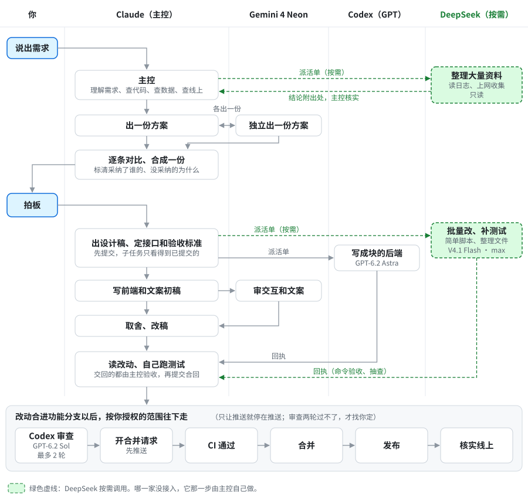
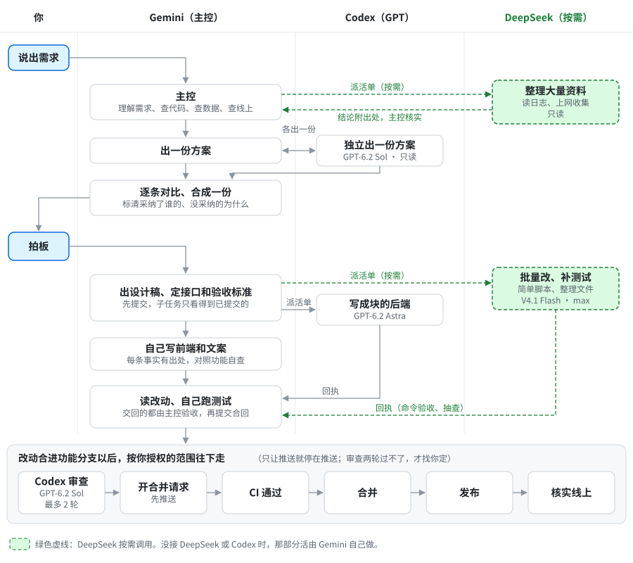

# t3-dispatch-skills

[English](README.md) | 中文

> **非官方社区工具（Unofficial）** — 与 T3 Tools Inc. 无隶属或官方背书关系。文中提到的 Claude、Gemini、Codex、DeepSeek 等名称归各自的所有者。

在桌面应用 [T3 Code](https://t3.codes) 里让几家 AI 自动分工的技能包，不用你在几个窗口之间来回传话：由 Claude 或 Gemini 当主控，负责理清需求、写前端、验收把关；大改动会拉另一家独立出第二份方案做对比；Codex 写重逻辑代码、守上线前审查；Gemini 把界面文字改成好懂的人话；DeepSeek 接简单但耗额度（token）的批量活。你只做两件事：提需求、拍板。

## 两种用法

| 用法 | 适合谁 | 主控 | 必须在 T3 Code 里接好 | 可选接入（有哪个接哪个） |
| --- | --- | --- | --- | --- |
| 标准 | Claude、Gemini、Codex 都有的人 | Claude | Claude、Antigravity（Gemini）、Codex | CodeBuddy（DeepSeek） |
| 最低门槛 | 没有 Claude，有 Gemini 和 Codex 的人 | Gemini | Antigravity（Gemini）、Codex | CodeBuddy（DeepSeek） |

DeepSeek 没接时，批量活由主控自己做。标准用法里如果暂时缺 Gemini 或 Codex 也能先用，缺的那一步由 Claude 自己做，只是少了第二份独立方案或独立审查（主控会提醒你）。这套分工只在 T3 Code 里能派子任务，在别处用会全部由主控自己做。下面两张图是完整分工流程，想直接装可往下滑到「安装」。

**Claude 当主控**



**Gemini 当主控（Gemini + Codex）**



## 安装

先按手头有的账号选一种，只照那一种装：

| 你手上有 | 选这种 | 怎么装 |
| --- | --- | --- |
| Claude、Gemini 和 Codex | 标准用法 | 在命令行跑两条命令装插件（看下面**第 1 种**，跳过第 2 种） |
| 没有 Claude，有 Gemini 和 Codex | 最低门槛 | 下载本仓库后跑一条脚本（看下面**第 2 种**，跳过第 1 种） |

**注意**：两种用法只装一种，中英文版也只装一个，同时装会让两套规则打架。如果之前装过另一种或别的语言版本，先按对应小节末尾的方法卸载。下文说的"终端/命令行"，在 Mac 上是「终端」，在 Windows 上是 PowerShell。

### 准备（两种都要）

1. 装好桌面应用 T3 Code（已在 v0.1.12 验证过）。
2. 打开 T3 Code，按上面表格把要用的 AI 账号接好并登录（Gemini 在里面叫 Antigravity，DeepSeek 叫 CodeBuddy）。
3. **选第 2 种必须装好 Node.js**（安装脚本要靠它运行）。选第 1 种不装也能正常用，装了会自动挑选当天表现最好的 Codex 思考档位（查不到评分时沿用上次的结果，从没查到过才用默认的 `high` 档），没装就固定用 `high` 档。

### 第 1 种：标准用法（Claude 当主控）

T3 Code 里的 Claude 直接共用本机 Claude Code 的插件，在命令行里装一次就能自动生效。

1. 确认电脑装了命令行版 Claude Code（在终端运行 `claude --version` 能看到版本号；没有就先按 Claude Code 官方说明装好）。
2. 在终端依次运行这两行命令：

   ```
   claude plugin marketplace add anning777/t3-dispatch-skills
   claude plugin install t3-dispatch-skills@t3-dispatch-skills
   ```

   想装英文版，把第二行换成 `claude plugin install t3-dispatch-skills-en@t3-dispatch-skills`。如果人已经在 Claude Code 的终端对话里，直接发 `/plugin marketplace add anning777/t3-dispatch-skills` 和 `/plugin install t3-dispatch-skills@t3-dispatch-skills` 也行。
3. 回到 T3 Code，**新开**一个模型选 Claude 的对话（旧对话里不会生效）。每次新开对话都会由钩子自动带上规则，不用改你自己的 CLAUDE.md。
4. 确认装好：在新对话里问一句"你现在有哪些多模型派活规则"，它能说出 Claude 当主控的分工就成了。**到这里已装好，直接跳到「装好以后怎么用」，跳过下面的第 2 种。**
5. 日后更新或卸载（首次安装不用做）：更新先运行 `claude plugin marketplace update t3-dispatch-skills` 刷新目录，再运行 `claude plugin update t3-dispatch-skills@t3-dispatch-skills`，然后新开对话；卸载运行 `claude plugin uninstall t3-dispatch-skills@t3-dispatch-skills`。若装的是英文版，把这两条里的插件名换成 `t3-dispatch-skills-en`。

### 第 2 种：最低门槛（Gemini 当主控）

T3 Code 里的 Gemini 不读插件，只读 `~/.gemini/config` 文件夹里的规则和技能，所以用一条脚本把文件复制过去就行。

1. 下载本仓库：在本页右上角点绿色的 Code → Download ZIP 下载并解压成文件夹（会用 git 也可以运行 `git clone https://github.com/anning777/t3-dispatch-skills.git`）。
2. 打开命令行，**先进入刚解压出来的仓库文件夹**，再运行：

   ```
   node scripts/install-gemini.mjs --lang zh
   ```

   看到屏幕打印出一排 `installed` 就装好了（脚本已把主控规则放进 `~/.gemini/config/rules/t3-dispatch-skills.md`，把 6 个技能放进 `~/.gemini/config/skills/`）。要英文版就把参数换成 `--lang en`。如果目录里原本就有不是它装的同名文件，脚本会立刻停下、什么都不改，并列出冲突的名字让你先处理。
3. 回到 T3 Code，**新开**一个模型选 Gemini 的对话（旧对话里不会生效）。
4. 确认装好：在新对话里问一句"你现在有哪些多模型派活规则"，它能说出 Gemini 当主控的分工就成了。
5. 日后更新或卸载（首次安装不用做）：更新时重新下载最新仓库，进文件夹再跑一遍上面的安装命令（你自己改过的文件会保留不覆盖）。卸载运行 `node scripts/install-gemini.mjs --uninstall`，只删它装的、且你没改过的文件；如果主控规则那一行显示 `kept`（因为你改过它，脚本没删），规则还会继续生效——照那一行打印的路径把文件移出所在的规则文件夹就能停用，最后新开一个 Gemini 对话确认。

**排错（只有第 4 步新开对话仍答不出规则时才看）**：少数情况下，T3 Code 没有把 Gemini 的规则和技能目录指向默认的 `~/.gemini/config`（去 T3 Code 数据目录下的 `providers/antigravity/<编号>/config` 里，看 `rules`、`skills` 实际指向哪）。这时加上 `--dest <那个 config 目录>` 装到它真正读取的位置；以后更新和卸载也都要带上同一个 `--dest`，例如更新用 `node scripts/install-gemini.mjs --lang zh --dest "<那个 config 目录>"`，卸载用 `node scripts/install-gemini.mjs --uninstall --dest "<那个 config 目录>"`——不带的话脚本只认默认目录，自定义目录里的规则不会被卸掉。

### 装好以后怎么用

平时只在 T3 Code 里开一个**主控模型**（Claude 或 Gemini）的对话，像平时一样说需求就行，不用自己切换别的模型：小改动主控直接改；大改动拉另一家出两份独立方案，合成一份等你拍板；成块的后端派 Codex 在后台写；批量的简单活派 DeepSeek 做；准备上线前先派 Codex 审查（没接 Codex 时由主控自己审，并提醒你这次没有独立审查）。想直接指定某一步，也可以点名技能，比如"用 dual-plan 出两份方案"。

**举个例子**：你在 Claude 的对话里说"给记账应用加一个按月导出表格的功能"。Claude 先看代码，判断这是个大改动，就和 Gemini 各出一份方案，合成一份发给你；你回一句"就按这个做"，它把导出的后端派给 Codex 在后台写，自己做页面，再请 Gemini 改按钮和提示文字；做完派 Codex 审查，通过后按你授权的范围推送、开合并请求、合并。整个过程你只说了两次话。

## 6 个技能

平时不用记这些名字，主控会按任务自动用；你想手动指定时也可以直接点名：

| 技能 | 管什么事 |
| --- | --- |
| dual-plan | 做大方案：主控出一份，另一家在后台独立出一份（Claude 主控派 Gemini，Gemini 主控派 Codex），主控核实事实后合成一份等你拍板 |
| gemini-advisor | 改界面文字和操作流程：主控先做出能用的一版，再请 Gemini 把提示和按钮改成大白话，核实没乱承诺后再用（Gemini 主控时自己按这套标准改） |
| codex-worker | 写成块代码：目标明确的后端、算法、数据处理，派 Codex 在单独的代码副本（工作树）里写，主控跑测试验收后再合进来 |
| deepseek-worker | 干耗额度的批量活：批量改文件、补测试、写简单脚本、整理日志、按步骤收集资料 |
| codex-review | 上线前把关：派 Codex 查代码，只拦真会出事故的大问题，最多审两轮，两轮还不过交给你定；通过后按你交代的范围走推送、开合并请求、等自动检查、合并 |
| lesson-to-check | 防再犯错：被你纠正或审查打回后，顺手把同类问题写成自动检查挡住，写不成检查才记成文字规则 |

## 安全

- **高风险操作先问你**：遇到删数据、停服、花钱、对外发消息、改产品方向、新建或轮换密钥、修改权限，做到最后一步之前，主控会先停下来问你。
- **写代码先隔开、验收再合入**：派出去写代码的 AI 都在单独的代码副本（独立工作树）里改，派活单要求它们不碰你正在改的文件，也不让它们装依赖、提交或推送代码；交回后由主控核对改动范围、跑过测试才合进来。
- **权限边界说明**：独立工作树只隔开了改代码的文件夹，**不是安全沙箱**——子任务在 T3 Code 里默认拥有和你一样的电脑读写权限。本仓库里的脚本和自动加载规则的钩子也会用你的电脑权限运行，装之前可以先翻看仓库代码。
- **按现状提供**：本项目不对使用结果作任何保证。建议先在不要紧的项目里试用，熟悉它会做哪些事，再用到正式项目上。

## 常见问题

**会额外花钱吗？** 这套技能包免费，也不经过任何第三方服务器。各家 AI 用的都是你在 T3 Code 里登录的账号，按各家自己的套餐或用量计费。技能包自己只联网做一件事：codex-worker 的档位脚本每天读一次 codexradar.com 公开的评分。

**会改动我自己的规则文件吗？** 不会。标准用法的规则由插件在新对话开始时自动带上，卸载插件后新开的对话里就不再生效；最低门槛只往 `~/.gemini/config` 里放它自己的文件，卸载时也只删它装的、你没改过的文件。

**想按自己的习惯改规则怎么办？** 建议先 Fork 本仓库再改，然后从你自己的仓库安装（把安装命令里的 `anning777/t3-dispatch-skills` 换成你的仓库；之前装过本仓库的，先运行 `claude plugin marketplace remove t3-dispatch-skills` 去掉原来的插件来源）。直接改已安装的插件文件，下次更新时会被覆盖。

## 反馈

用着有问题或有改进的想法，欢迎在 [Issues](https://github.com/anning777/t3-dispatch-skills/issues) 里提，也欢迎直接提交合并请求。

## 致谢

这套分工的思路，以及主控规则和技能里的部分原文，来自小红书博主「数字生命卡兹克」公开分享的帖子[《给三个顶流 AI 分完岗，爽飞了》](https://www.xiaohongshu.com/discovery/item/6b03ebf9000000002a02b8ca?xsec_token=ABp9uzhyoakoyNlHW_3SGNTpSDEglA066jpvlWJUG6QQg=&xsec_source=pc_share)和帖子附带的 CLAUDE.md。本仓库把那套做法搬到 T3 Code，并按 T3 Code 的派活方式做了改写和补充；内容不代表原作者。

Codex 每天用哪个思考档位，依据的是 [codexradar.com](https://codexradar.com) 公开的实测评分。


## 许可

[MIT](LICENSE)
